  

  
   
  <b>That's me, in 3D</b>, dragging my name onto my portfolio. Six projects, each with its own 3D world. <a href="https://portfolio-green-nine-58.vercel.app"><b>Step inside →</b></a>

 

### I build AI people can trust.

Answers that **cite their source**. Models that **explain themselves**. Apps that **keep working offline**.
I'm an AI/ML engineer (B.Tech AI & ML, graduating Oct 2026) who takes models past the notebook: into APIs, phones, and the hands of people who aren't engineers.

 

## Featured work

  
  

  

<a href="https://promptivo.live/app">Tender Intelligence is live →</a>

<b>More I've built</b>

 

| | |
|---|---|
| **Unauthorised construction detection** | PostGIS + Web GIS for a Sentinel-2 / SAR / Cartosat-3 ensemble with 5-day automated alerts |
| **XAI-Care** | Multimodal fall detection; Grad-CAM and SHAP explain every alert to caregivers |
| **Water Survey** | Offline-first Flutter field app with geo-tagging and auto-sync |
| **Restaurant POS** | Offline Flutter + FastAPI + SQLite, role-based access and live analytics |
| **[3D portfolio](https://portfolio-green-nine-58.vercel.app)** | Three.js, a motion-captured avatar, per-project 3D worlds ([code](https://github.com/sanskrutin19/portfolio)) |

 

## Toolbox

  
   
  

Plus LangChain · Ollama · Hugging Face · ChromaDB · RAG · MCP · OpenCV · YOLOv8 · Grad-CAM · SHAP · WebRTC · Signal Protocol

 

## Experience & recognition

- **AI / ML Intern, Endureva Innovations** (Jan – Jun 2026): shipped a crop-disease diagnosis feature end to end; built an offline restaurant POS.
- **3rd Prize, Smart India Hackathon** (college level): sign-language learning app for English and Gujarati Sign Language.
- **Management Team Lead, Prabal Hackathon (GDG SGU)**: ran a 40-hour national hackathon for 600+ participants.
- **Certifications**: NPTEL AI for Management · ISRO Remote Sensing · Cloud & Edge Computing workshop (SGU) · Accenture job simulations

 

  <b>Have a difficult problem worth solving?</b>
    
  
  
  

